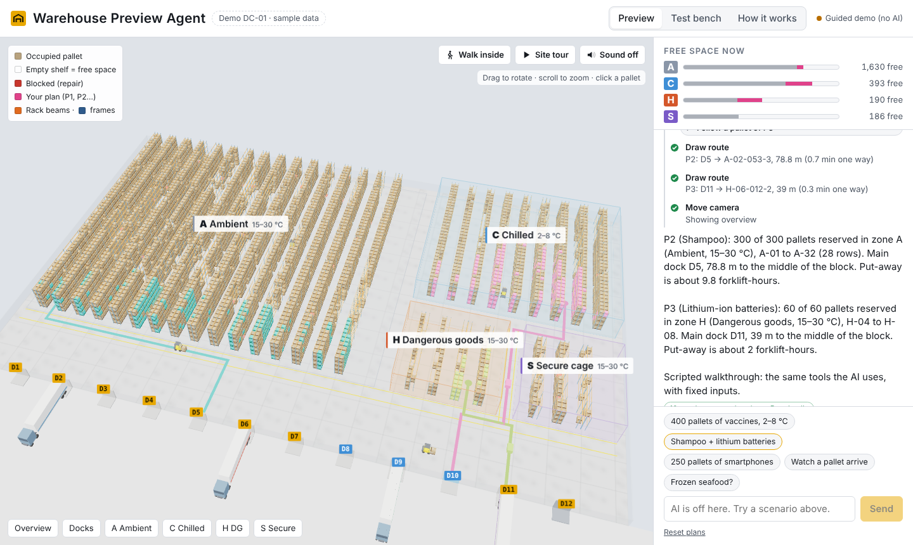
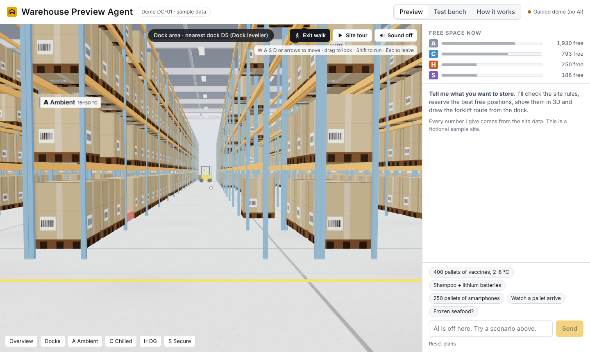
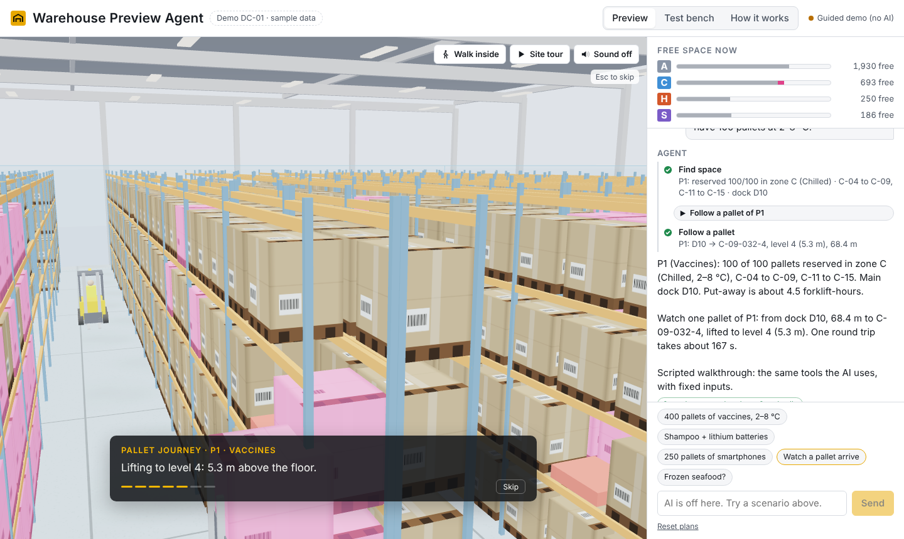
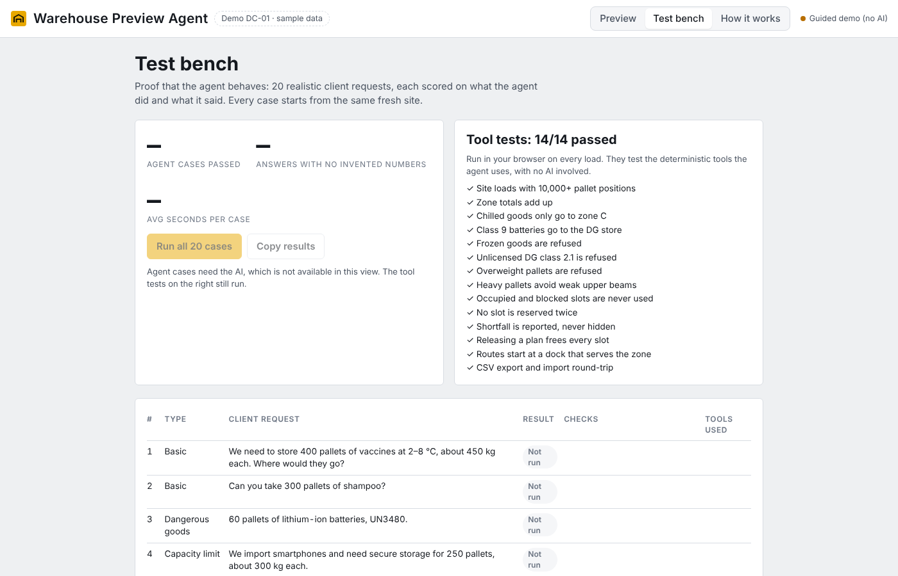
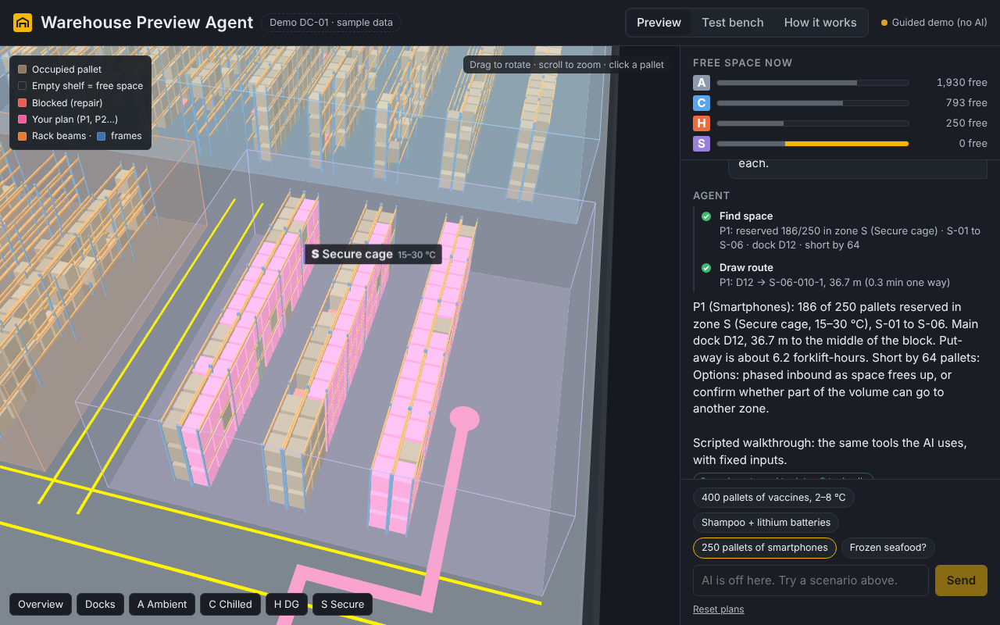
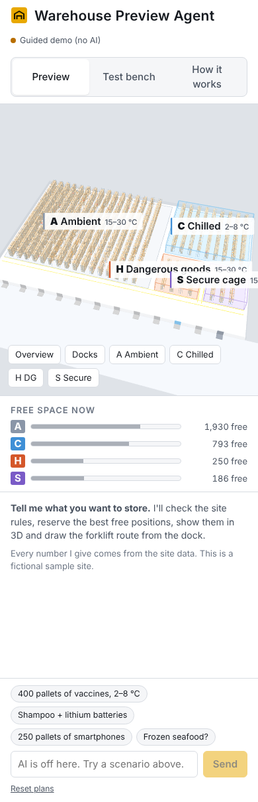

# Warehouse Preview Agent

**A client tells an AI agent what they want to store. The agent checks the site rules, reserves the best free pallet positions, shows them in a 3D model of the warehouse and draws the forklift route from the dock. Every number it says is traced back to the data.**

Concept prototype built for a hiring assignment. All site data is fictional ("Demo DC-01, Bhiwandi"). Not an official product of any company.

https://github.com/user-attachments/assets/8669480c-0c58-4040-b2b3-88689fdfae09

## Project management case study

How this project was planned, scoped, risk-managed and quality-tested: **[Read the case study](CASE_STUDY.md)**



## The problem

Before a client moves inventory into a warehouse, they want to know: *Will my goods fit? Is it the right environment? How will they flow? Is it safe?* Today that takes PDFs, sales calls and site visits. This prototype answers those questions in minutes, in a browser, with a 3D view the client can explore.

## What it does

| Ask | What the agent does |
|---|---|
| "400 pallets of vaccines at 2–8 °C, 450 kg each" | Picks the chilled zone, reserves the 400 positions closest to the reefer docks, highlights them in 3D, draws the route, estimates put-away effort |
| "300 pallets of shampoo and 60 pallets of lithium batteries (class 9)" | Makes two plans in two zones (ambient and dangerous goods) |
| "250 pallets of smartphones" | Places what fits in the secure cage and states the 64-pallet shortfall honestly |
| "Frozen seafood at −18 °C" / "propane, class 2.1" / "1,200 kg pallets" | Refuses, explains which rule applies, suggests options |
| "Actually make that 350 pallets" | Releases the old plan and re-plans |
| "Write a summary for Acme Pharma" | Produces a one-page client report |
| "Show me how a pallet gets to its shelf" | Plays the pallet's journey from truck to shelf in 3D |
| "Give me a tour" | Writes and plays a narrated tour of the site |

## An immersive experience

| Feature | What the client gets |
|---|---|
| **Walk inside** | Eye-level walking through the aisles (W A S D / arrows, drag to look, touch pad on phones), collisions with racks, a live "you are here" readout. The chilled chamber has a cold haze. |
| **Follow my pallet** | A truck backs onto the dock, a forklift carries one pallet along the real route and lifts it into its slot. Every caption comes from the plan's data: dock, location, distance, lift height, cycle time, total put-away hours. |
| **Guided tour** | Camera stops with captions, read aloud when sound is on. The agent can write a tour for a specific client; its captions go through the same number check as chat answers. |
| **A living site** | Shadows, concrete floor, labelled cartons on wooden pallets, roof trusses and lights from inside, trucks at the docks, forklifts at work, reversing beepers and hall ambience (synthesized, no audio files). |

Animations run on wall-clock time, and the renderer drops shadows automatically on slow devices.

| Walk inside | Follow my pallet |
|---|---|
|  |  |

## Why it can be trusted

1. **The AI decides; code calculates.** The model chooses which tools to call and explains the result. Capacity, rules, routes and estimates come from deterministic functions in [`src/core.js`](src/core.js).
2. **Every answer is checked.** After each reply the page compares every number in the text with the tool results and site data. Any number it cannot trace is flagged in orange.
3. **It is tested.**
   - 14 unit tests on the tools (`npm test`)
   - A 22-case **test bench** that scores the live agent on what it did and what it said (Test bench tab, or `npm run eval`)
   - A check that the test bench itself is fair: a scripted perfect agent scores 22/22 and typical mistakes fail ([`tests/eval-oracle.test.js`](tests/eval-oracle.test.js))
   - Browser tests of both agent loops with a simulated model (`npm run test:e2e`) and of the immersive features (`tests/e2e-immersive.js`)



## Architecture

```
Client ──► AI agent (Claude) ──calls──► Tools (deterministic) ──► Site data (slots.csv + zone rules)
              ▲     │                         │
              │     ▼                         └──► 3D view (Three.js, generated from the data)
          results  Number check (every figure traced to data)
```

**One agent turn:** the agent reads the request with live site data → calls tools (several in parallel when the client has several products) → reads the results → draws routes, re-plans or writes the report → answers in plain words → the page checks the numbers.

| Tool | What it does |
|---|---|
| `find_space` | Applies zone rules (temperature, DG class, beam load, height), reserves the nearest free positions, highlights them and moves the camera |
| `draw_route` | Draws the forklift route from a dock that serves the zone; returns distance and time |
| `move_camera` | Flies to the overview, docks, a zone, a dock or a plan |
| `get_site_status` | Live free, occupied, blocked and reserved positions per zone |
| `release_plan` | Cancels a plan and frees its positions (for re-planning) |
| `create_client_report` | One-page summary with totals, notes, open questions and assumptions |
| `follow_pallet` | Plays the truck-to-shelf journey of one pallet and returns its facts |
| `give_tour` | Plays a narrated camera tour with the agent's own captions |

### Three ways it runs

| Mode | When | Brain |
|---|---|---|
| In Claude | The published claude.ai link, viewer signed in | Claude, through the page's `sample` capability |
| Own API key | `npm start` on a laptop, or hosted on Render | Groq, Gemini or Claude, relayed by `server.js` (key stays on the server) |
| Guided demo | No AI available | Scripted scenarios that call the same tools, clearly labelled |

## The sample site

| Zone | Positions | Rules | Docks |
|---|---|---|---|
| A Ambient | 7,168 | 15–30 °C, 1,000 kg on levels 1–2, 800 kg on 3–4 | D1–D7 |
| C Chilled | 2,304 | 2–8 °C (GDP), 800 kg | D8–D10 (reefer) |
| H Dangerous goods | 384 | DG classes 3, 8, 9 only | D11 |
| S Secure cage | 288 | High-value goods, 600 kg | D12 |

10,144 pallet positions, 160 × 100 m, 12 docks, 1.6 m maximum pallet height. No frozen storage. Some positions are blocked for beam repair and must be avoided. Location codes follow `Zone-Row-Bay-Level`, e.g. `C-04-012-2`.

### Use real data

The site is a CSV with the columns a warehouse management system export can be mapped to:

```
location_id,zone,row,bay,level,x_m,z_m,aisle_x_m,max_kg,status,note
```

Load one on the **How it works** tab. The 3D view and the agent switch to it immediately. `npm run build` writes the sample to [`data/slots.csv`](data/slots.csv) and [`data/site.json`](data/site.json).

## Run it

Requires Node 18 or later. The only dependency is three.js, served locally so the laptop version works offline.

```bash
npm install            # installs three.js
cp .env.example .env   # add ONE key: Groq or Gemini (free) or Claude
npm start              # http://localhost:3000
```

Without a key the app opens in guided-demo mode.

| Provider | Key | Cost | Default models (change with `MODEL` / `MODEL_FAST`) |
|---|---|---|---|
| Groq | `GROQ_API_KEY` | free tier, no card | `openai/gpt-oss-120b`, Fast: `openai/gpt-oss-20b` |
| Gemini | `GEMINI_API_KEY` | free tier | `gemini-3.8-flash` |
| Claude | `ANTHROPIC_API_KEY` | paid | `claude-sonnet-4-5`, Fast: `claude-haiku-4-5` |

Model names change over time; check your provider's console if a call fails with "model not found".

## Put it online for everyone (free)

Anyone with the link can then chat with the AI, no account needed. Your key stays on the server.

1. Put this project on GitHub.
2. Get a free key at [console.groq.com/keys](https://console.groq.com/keys).
3. On [render.com](https://render.com): **New + → Blueprint**, pick the repository. Render reads `render.yaml` and asks for `GROQ_API_KEY`; paste the key.
4. Open the `onrender.com` link it gives you. On the free plan the first visit after a quiet period takes up to a minute to wake up.

The server limits each visitor to 40 AI calls per 10 minutes and everyone together to 1,500 per day (`LIMIT_PER_IP`, `LIMIT_PER_DAY`), so a shared link cannot use up your key. After deploying, run the Test bench on the live site: scores depend on the model.

| Command | What it does |
|---|---|
| `npm start` | Build and serve the app |
| `npm test` | Tool unit tests + test-bench fairness check |
| `npm run test:e2e` | Browser tests: Claude loop, Groq/Gemini loop, immersive features (needs Playwright) |
| `npm run eval` | Run the 22 cases on the Fast model with your key, write `eval/results-fast.md` |
| `npm run eval:thorough` | Same on the Thorough model |

## Project structure

```
src/core.js          site model, rules and tools (pure logic, shared by browser and Node)
src/scene.js         3D viewer (Three.js r128), built from the data
src/immersive.js     walk mode, pallet journey, guided tour, living site, sound
src/agent.js         tool definitions, instructions, agent loops, number check, guided demo
src/eval.js          22 test cases, scoring, in-browser test bench
src/about.js         "How it works" page and CSV loader
src/app.js           UI wiring
server.js            server and API relay for Groq, Gemini or Claude, with per-visitor limits (no dependencies)
render.yaml          one-click free hosting on Render
scripts/             build, data export, command-line eval
tests/               unit, fairness and browser tests
dist/                built single-file app
```

## Design decisions

- **Tools return small, plain results.** The model reads facts it can quote, not raw slot lists, which keeps answers grounded and calls fast.
- **Rules live in code, not in the prompt.** The prompt tells the agent to use the tools; the tools enforce the rules. A clever prompt cannot talk the agent into putting propane in the chilled room.
- **Nearest-to-dock slotting.** Positions are chosen by forklift travel distance from the zone's docks, then by lowest level, which is a common first-pass put-away strategy.
- **Honest shortfalls.** When a zone is full the agent says so; it never spills goods into a zone the rules forbid.
- **One file to share.** The build inlines everything into a single HTML page, so the demo is one link.

## Limitations and next steps

- Occupancy is a CSV snapshot. Next: read live occupancy from the warehouse management system API.
- Layout comes from data. Next: "floor plan in, layout out", where a vision model drafts racking from a drawing, a validator agent checks it and a person approves.
- Geometric 3D. Next: overlay the data on a photo-real scan (Gaussian splat) of the real building.
- Estimates use fixed assumptions (2 m/s forklift, 75 s handling, +8 s per level). Next: site-specific engineering standards and cost-to-serve quotes.
- Production needs single sign-on, per-client data isolation and an audit log of every tool call.

## Screenshots

| Shortfall, dark mode | Phone |
|---|---|
|  |  |
